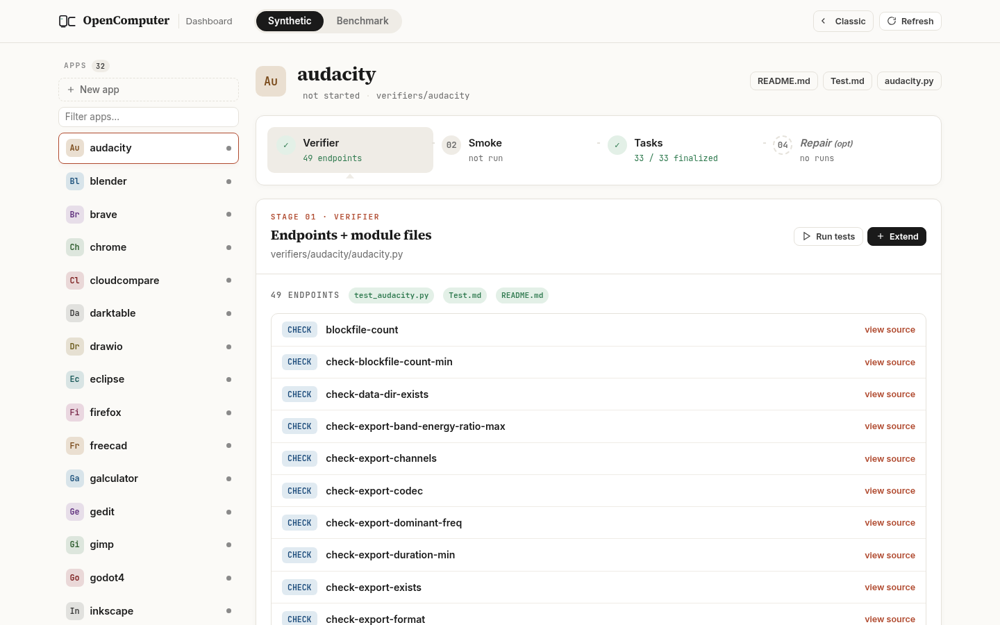
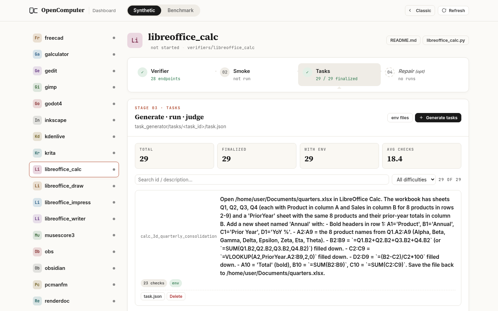
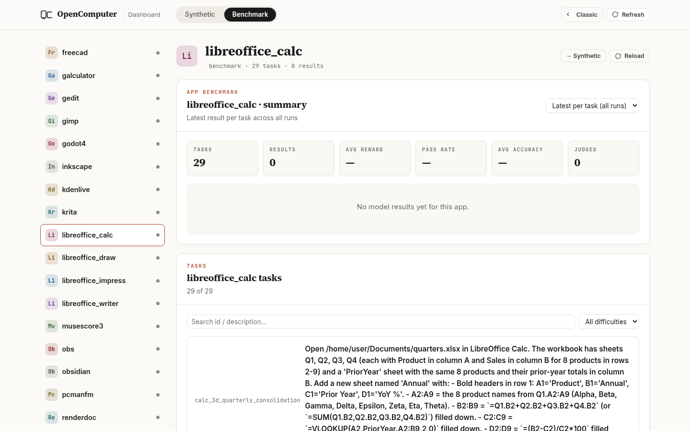

<h1 align="center">
  <picture>
    <source media="(prefers-color-scheme: dark)" srcset="docs/opencomputer-white.svg" />
    
  </picture>
  <br />
  OpenComputer —— 面向计算机操作智能体的可验证软件世界
</h1>

<p align="center"><a href="README.md">English</a> · <b>简体中文</b></p>

<p align="center">
  <strong>用于训练与评测计算机操作智能体（Computer-Use Agent）的无限合成环境</strong>
</p>

<p align="center">
  <a href="https://echo0715.github.io/OpenComputer" target="_blank" rel="noopener">
    
  </a>
  <a href="https://arxiv.org/pdf/2605.19769" target="_blank" rel="noopener">
    
  </a>
  <a href="#合成快速开始">
    
  </a>
  <a href="#评测快速开始">
    
  </a>
  <a href="./LICENSE">
    
  </a>
</p>

**OpenComputer** 是一个以验证器为基础、为计算机操作智能体构建可验证软件世界的框架。它由四部分组成：（1）针对具体应用的状态验证器，为真实应用提供结构化的检查端点；（2）自进化的验证层，利用基于执行的反馈提升验证器可靠性；（3）任务生成流水线，合成真实且可机器检查的桌面任务；（4）评测框架，记录完整轨迹并计算可审计的部分得分。目前 OpenComputer 覆盖 33 个桌面应用、1,000 个定稿任务，涵盖浏览器、办公软件、创意软件、开发环境、文件管理器和通讯应用。实验表明，OpenComputer 的硬编码验证器比 LLM-as-judge 更贴近人工判定，尤其是在成功与否取决于细粒度应用状态时。前沿智能体虽然能取得部分进展，但难以端到端完成任务；开源模型相较其 OSWorld-Verified 分数出现明显下滑，暴露了鲁棒计算机自动化方面持续存在的差距。

---

## 为什么是“合成”

人工编写的 GUI 基准无法规模化——每个任务都需要独特的工作簿、项目文件或屏幕状态，也都需要一个知道去哪里检查的验证器。`OpenComputer` 把两边都自动化了：

- **任务是生成的**，而不是手写的。任务生成器（`task_generator/`）提出目标，按复杂度和输入文件是否易于合成打分，把每个被接受的目标匹配到一个验证器端点，最终输出 `task.json` 和完整合成的 `env/` 输入文件目录（CSV、ODT/ODS/ODP/XLSX 文档、PNG/SVG 图片、项目文件、配置等）。
- **环境可复现**。每个任务都带有初始化沙箱所需的全部文件；运行时上传这些文件、启动对应应用，并在应用就绪后才把控制权交给智能体。
- **验证以程序为主、LLM 判定为辅**。每个应用都有一个验证器模块，提供 `check-*` 命令行端点，读取实时 IPC 状态（CDP、D-Bus、UNO、AT-SPI）、解析磁盘文件或查询 SQLite 配置数据库。自动检查不够时，由 LLM 评审兜底。

---

<a id="合成快速开始"></a>

## 合成快速开始

### 前置条件

```bash
cp .env.example .env
pip install -r requirements.txt
```

然后确认以下条件已满足：

| 需求 | 用途 | 设置方法 |
|---|---|---|
| **E2B 沙箱** | 每个阶段都会启动 `desktop-all-apps` 模板 | 在 `.env` 中设置 `E2B_API_KEY`，然后运行一次 `python computer_env/provision/e2b/build_all_apps_template.py` |
| **推理后端 CLI** | 驱动验证器编写、smoke 评审 / 比较 / 修复和任务生成 | 安装并登录 `claude`（默认）或 `codex`。`.env` 中的 `SMOKE_BACKEND` 选择 `smoke/smoke_loop.py` 使用的 CLI（默认 `claude`） |
| **Smoke GUI 智能体 Key** | 在沙箱中实际执行 smoke 任务的智能体 | 设置与 `SMOKE_MODEL` 对应的 API Key（默认 `kimi-k2.6` → `KIMI_API_KEY`）。改用 Claude / GPT / Gemini 等时覆盖 `SMOKE_MODEL` 并设置对应的 Key |
| **LLM 评审 Key**（可选） | 仅当验证检查标记为 `judge: llm` 时使用 | `JUDGE_MODEL` 默认 `gpt-5.4` → `OPENAI_API_KEY`。可改模型以复用已有的 Key |

### 流水线顺序

流水线严格按顺序执行——验证器质量决定任务质量，任务质量决定评测质量：

1. **验证器**（[`verifiers/`](./verifiers/README.md)）：生成每个应用用于给任务打分的 `check-*` 端点。
2. **Smoke**（[`smoke/`](./smoke/README.md)）：在真实沙箱中用真实智能体调用每个验证器端点，并修复发现的问题。
3. **任务生成**（[`task_generator/`](./task_generator/README.md)）：提出、评估任务，匹配验证器，并为定稿任务合成环境文件。

根目录的 [`CLAUDE.md`](./CLAUDE.md) 是权威指南。你可以：

- **自动化**：把 `CLAUDE.md` 交给编码智能体，让它端到端执行完整循环（合成验证器 → smoke 测试 → 生成任务 → 修复任务验证器（可选））。
- **手动**：按顺序阅读上面每个阶段的 README 逐步执行，并在阶段之间检查产出质量。

---

<a id="评测快速开始"></a>

## 评测快速开始

### 1. 安装

```bash
git clone <本仓库>
cd OpenComputer
cp .env.example .env       # 填写后端相关变量和你计划使用的模型 API Key
pip install -r requirements.txt
```

`requirements.txt` 会从 PyPI 安装 E2B core SDK 和 Desktop SDK，以及 `anthropic`、`openai`、`dashscope`、`Pillow`、`httpx`、`python-dotenv` 等。

### 2. 准备后端

任选**一个**后端：

```bash
# E2B（云沙箱，推荐，也是标准目标）
python computer_env/provision/e2b/build_all_apps_template.py

# Docker（本地，适合离线迭代）
bash computer_env/provision/docker/build_image.sh

# remote_docker（AWS 或腾讯云 worker 集群）
# 按对应的部署指南操作：
#   computer_env/provision/aws/README.md
#   computer_env/provision/tencentcloud/README.md
```

三个后端使用相同的 Ubuntu/XFCE 桌面栈并预装全部应用。E2B 构建会推送名为 `desktop-all-apps` 的模板；Docker 后端使用 OCI 镜像。

完整的 `remote_docker` 部署流程请直接参考：

- [`computer_env/provision/aws/README.md`](./computer_env/provision/aws/README.md)
- [`computer_env/provision/tencentcloud/README.md`](./computer_env/provision/tencentcloud/README.md)

这些文档是以下内容的权威来源：云厂商认证校验、前置资源（`setup_prereqs.py`）、桌面镜像构建与推送、worker 启动 / 画面查看 / 销毁，以及 `run_eval.py --env-backend remote_docker` 的用法和运行说明。

### 3. 运行评测

```bash
# 单个任务
python evaluation/run_eval.py --app chrome --task chrome_form_fill_httpbin --model claude-sonnet-4-6

# 某个应用的全部任务，并行执行
python evaluation/run_eval.py --app libreoffice_calc --model gpt-5.4 --parallel 4

# 在 Docker 上每个应用冒烟测试一个任务
python evaluation/run_eval.py --env-backend docker --tasks-per-app 1

# 在远程 Docker 集群上运行
python evaluation/run_eval.py \
  --env-backend remote_docker \
  --docker-image <remote-registry>/<repo>:latest \
  --tasks-per-app 1 \
  --parallel 2

# 每个应用抽样 N 个任务
python evaluation/run_eval.py --tasks-per-app 3 --model kimi-k2.6

# 继续之前的运行（跳过已完成的任务）
python evaluation/run_eval.py --resume <run_id>

# 让智能体使用本地 OpenAI 兼容端点
python evaluation/run_eval.py --model gui-owl-1.5 --endpoint-port 8001
```

轨迹、截图和 `report.json` 保存在 `evaluation/runs/<run_id>/`（已被 git 忽略）。

---

## 仪表盘与截图

本地 Web 仪表盘（`dashboard/server.py`，基于 Flask）展示每个应用的流水线状态——验证器端点、smoke 运行、生成的任务和修复运行——以及 `evaluation/runs/` 中的评测结果。它直接读取仓库内容，不需要任何 API Key；从仪表盘启动沙箱则需要上面的后端 Key。

```bash
pip install flask          # 仪表盘唯一的额外依赖（不在 requirements.txt 中）
python dashboard/server.py --port 5111   # 然后打开 http://127.0.0.1:5111
```

以下截图来自在全新克隆的仓库上运行的仪表盘（尚无运行记录）：

| 验证器端点（`audacity`，49 个 `check-*` 端点） | 生成的任务（`libreoffice_calc`） |
| --- | --- |
|  |  |

| 评测视图 |
| --- |
|  |

---

## 项目结构

```
agents/            GUI 智能体实现与注册表（Claude、ChatGPT、Gemini、Kimi、Qwen、GUI-Owl、EvoCUA 等）
computer_env/      沙箱后端（E2B、Docker、remote_docker）与部署脚本（AWS、腾讯云）
verifiers/         每个应用一个模块，对实时应用状态提供 `check-*` 命令行端点
smoke/             smoke 循环：用真实智能体调用验证器端点并修复问题
task_generator/    任务提出、打分、匹配验证器、合成环境文件；定稿任务在 tasks/
evaluation/        run_eval.py 评测框架、运行时、LLM 评审、修复循环
dashboard/         本地 Flask 仪表盘（server.py + static/）
docs/              项目网站、Logo、README 截图
CLAUDE.md          给编码智能体的端到端权威指南
```

---

## 支持的智能体

智能体注册表（`agents/registry.py`）把易记的别名映射到智能体类和合理的默认参数。把任意别名传给 `--model` 即可。

| 系列 | 别名 |
|---|---|
| **Claude**（Anthropic） | `claude-sonnet-4-5`、`claude-sonnet-4`、`claude-sonnet-4-6`、`claude-opus-4`、`claude-opus-4-1`、`claude-opus-4-5`、`claude-opus-4-6`、`claude-3-7-sonnet` |
| **ChatGPT**（OpenAI / Azure） | `chatgpt`、`gpt-5`、`gpt-5.4`、`computer-use-preview`、`azure-chatgpt`、`azure-gpt-5.4`、`azure-computer-use-preview`、`azure-gpt-5.3-chat` |
| **Gemini**（Google AI Studio） | `gemini-3-flash`、`gemini-3-flash-preview`、`gemini-2.5-computer-use` |
| **Kimi**（Moonshot） | `kimi-k2.5`、`kimi-k2.6` |
| **Qwen**（DashScope / OpenAI 兼容） | `qwen3-vl`、`qwen2.5-vl-72b`、`qwen3.5-35b-a3b`、`qwen3.5-27b`、`qwen3.5-9b`、`qwen3.5-4b` |
| **GUI-Owl** | `owl1.5`、`gui-owl-1.5` |
| **EvoCUA** | `evocua-s1`、`evocua-s2` |
| **Holo**（H Company） | `holo-3.1`、`Hcompany/Holo-3.1-35B-A3B` |
| **专用 CUA 模型** | `mano`、`opencua`、`dart` |

`python evaluation/run_eval.py --list-models` 会列出当前注册的全部模型。未知的模型 ID 会按系列启发式路由（名称中包含 `claude`、`kimi`、`qwen`、`gemini`、`gpt-` 等），因此也可以直接传入厂商的完整模型 ID。

---

## 配置概览

本节只列出运行评测时大多数用户需要的顶层变量。后端相关和运维相关的设置见：

- [`computer_env/README.md`](./computer_env/README.md)：沙箱 / 后端运行时设置
- [`computer_env/provision/aws/README.md`](./computer_env/provision/aws/README.md)：AWS 上的 `remote_docker`
- [`computer_env/provision/tencentcloud/README.md`](./computer_env/provision/tencentcloud/README.md)：腾讯云（中国区）上的 `remote_docker`
- [`evaluation/repair/README.md`](./evaluation/repair/README.md)：修复相关设置
- [`.env.example`](./.env.example)：配置模板

### 常用评测设置

| 变量 | 默认值 | 用途 |
|---|---|---|
| `EVAL_MODEL` | `kimi-k2.6` | `evaluation/run_eval.py` 的默认智能体 |
| `EVAL_MAX_ITERATIONS` | `100` | 每个任务最多的“截图-动作”步数 |
| `EVAL_SANDBOX_TIMEOUT` | `3600` | 每个任务沙箱的存活时间（秒） |
| `JUDGE_MODEL` | `gpt-5.4` | 验证时使用的 LLM 评审模型 |
| `SMOKE_BACKEND` | `claude` | `smoke/smoke_loop.py` 与 `evaluation/repair/repair_loop.py` 共用的推理后端 CLI（`claude` 或 `codex`），可用 `--backend` 按次覆盖。其他 `REPAIR_*` 选项见修复 README |

---

## 扩展 OpenComputer

- **新增应用**或**为已有应用增加任务** → 见上文 [合成快速开始](#合成快速开始)。
- **新增智能体** → 继承 `agents/base.py:BaseAgent`，把模型输出解析为 pyautogui 代码字符串（或特殊标记 `DONE` / `FAIL` / `WAIT`），并在 `agents/registry.py` 中注册别名。未知模型 ID 会按系列启发式路由，所以名称中包含 `claude`、`kimi`、`qwen`、`gemini`、`gpt-` 等的模型即使没有显式注册也能匹配到正确的智能体类。
- **新增后端** → 在 `computer_env/backends/<name>/` 下添加实现 `BaseComputerEnvironment` 的运行时适配器，在 `computer_env/factory.py` 中注册，并在 `evaluation/run_eval.py` 中加入 `--env-backend <name>` 分支。

---

## 引用

如果你在研究中使用了 OpenComputer 或觉得它有帮助，请引用：

```bibtex
@misc{wei2026opencomputerverifiablesoftwareworlds,
      title={OpenComputer: Verifiable Software Worlds for Computer-Use Agents}, 
      author={Jinbiao Wei and Qianran Ma and Yilun Zhao and Xiao Zhou and Kangqi Ni and Guo Gan and Arman Cohan},
      year={2026},
      eprint={2605.19769},
      archivePrefix={arXiv},
      primaryClass={cs.AI},
      url={https://arxiv.org/abs/2605.19769}, 
}
```

---

## 许可证

OpenComputer 以 [Apache License 2.0](./LICENSE) 发布。
