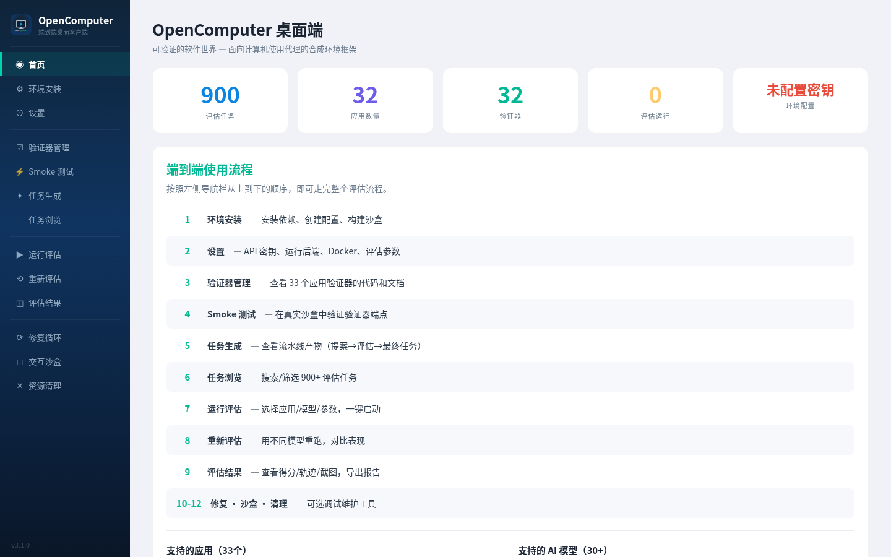
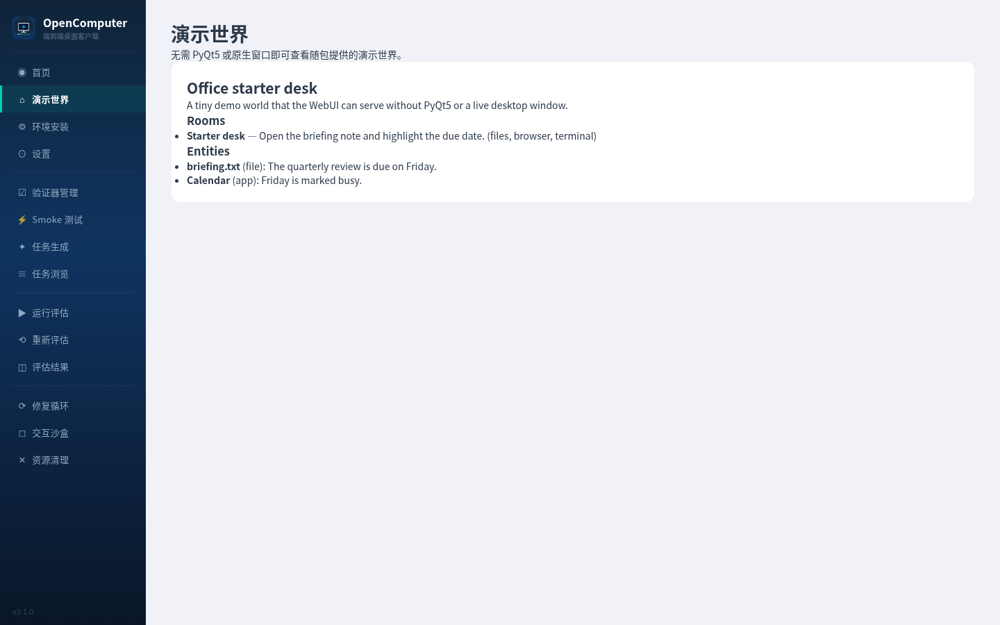

# OpenComputer

[English](./README.md) | **简体中文**

许可证未改。

## 演示世界（WebUI，不需要 PyQt5）

WebUI 通过 `/api/demo-world` 提供随包演示世界，并在「演示世界」页展示。不需要原生 PyQt5 窗口。





Flask WebUI 可以在不打开原生窗口的情况下提供一份启动桌面包：访问 `/api/demo-world`。

```bash
python -m pytest desktop_app/webui/test_webui_app.py
```
